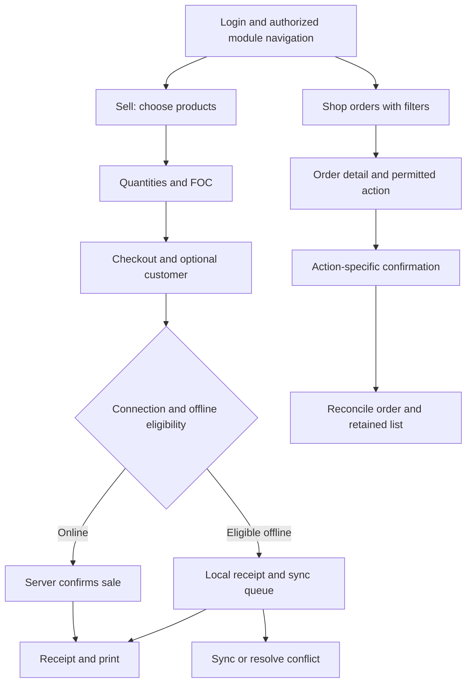

# Flows, permissions and state contracts

[Handoff home](../../UI-UX-HANDOFF.md) | [Screens](02-screen-specifications.md) | [QA](05-delivery-and-qa.md)

## Navigation is part of the design

Current navigation lives in [App](../../src/app/App.jsx), [historyNavigation](../../src/navigation/historyNavigation.js), [RetainedViews](../../src/navigation/RetainedViews.jsx), and [pageRefresh](../../src/navigation/pageRefresh.js). Keep their behavior when reorganizing the UI.

The visible Back button, browser Back and Android hardware Back should agree. Close the top interaction surface first; then return through actual app history. Directly opened detail routes need a sensible module fallback. A hardcoded parent URL is insufficient when the source was customer history, a report, an alert or another retained page.

Do not refetch merely because a retained page becomes visible again. Restore its query, filters, tab, loaded rows, paging position, inner scroll, window scroll, selected items and appropriate focus. Mutations reconcile affected data using existing refresh/change mechanisms without discarding unrelated source-page state. Account/session/offline identity changes invalidate the appropriate retained views and drafts; never show one business's data in another business's frame.

| Transition | Required behavior |
| --- | --- |
| List -> detail -> Back | Same search, applied filters, page/loaded records and scroll; no full skeleton flash on return. |
| Detail -> edit -> Cancel | Same detail context; no mutation and no unrelated list reset. |
| Detail -> edit -> Save | Reflect saved entity and balances where relevant; return with source filters/scroll intact. |
| Filter open -> Close/Escape/backdrop/Back | Dismiss drawer safely; preserve draft/commit behavior from the owning module; no accidental Apply. |
| Retained page becomes inactive | Release active dialog top layer, scroll lock and camera/device resources as appropriate; keep intended draft. |
| Direct action/detail URL | Load necessary context, enforce permission, show missing/denied state, use valid fallback on Back. |
| Customer history -> order -> Back | Same customer and history state, same shared OrderCard layout. |
| Customer detail -> chat -> profile -> Back | Profile opens customer detail; Back follows actual origin, restores conversation/draft/history context. |
| Hardware Back in sheet/drawer/camera | Consume close action first; avoid unintended navigation or app exit. |
| Logout/session change | Clear sensitive retained identity and close overlays; existing server/session handling remains authoritative. |

The right filter drawer uses a native dialog and stays within module localization. Conversation disables pull-refresh gestures in its message area to avoid competing with history scrolling. Do not introduce nested scroll containers unless they have a deliberate restoration and keyboard strategy.

## Principal task flows

| Task | Sequence and essential contract |
| --- | --- |
| Sell online | Search/scan -> select correct price -> quantity/FOC -> customer if required -> payment -> submit -> receipt. Prevent duplicate submit; print failure is not sale failure. |
| Sell offline | Eligible cached session/products -> supported checkout -> local identity/receipt -> pending queue -> sync -> server result/conflict. Never erase conflict records or imply all modules work offline. |
| Receive stock | Supplier/reference -> products -> buying units/FOC/cost -> payment/review -> optional below-cost warning -> save. Preserve conversions and stock/account effects. |
| Record customer/supplier movement | Open party -> choose direction -> amount/method/note -> confirm -> reconcile ledger and balance. Explicit text describes who pays whom. |
| Fulfill shop order | Filter orders -> inspect status/payment/request -> choose permitted icon+label action -> complete required evidence/reason -> confirm -> reconcile order/list. No arbitrary state jump. |
| Process proof/payment/refund | Inspect private proof/receiving account/amount -> verify or reject under permissions -> honor full-payment/refund/return/POS prerequisites -> retain audit. |
| Handle buyer | Search buyer -> profile/statistics -> filter order history -> open order or chat -> Back to same context. Credit contact linking is a separate explicit operation. |
| Chat | Inbox or buyer action -> thread -> read history -> attach product/image or text -> send -> pending/success/retry with same client identity. Profile group navigates to buyer detail. |
| Reply to review | Filter reviews -> inspect customer rating/target/comment -> reply editor -> save -> updated reply in retained list. Blank edit removes reply; make consequence clear. |
| Publish catalog | Filter -> review scope -> publish/unpublish matching products -> confirmation -> reconcile. All matches differs from visible page. |
| Run promotion | Choose coupon/flash sale -> identity/discount/schedule -> optional product selection -> review -> save. Used-item locks and selection limits remain enforced. |
| Request plan | Billing -> package -> receiving account -> proof/reference -> submit -> pending office review. No instant activation promise. |
| Configure output | Receipt/barcode template -> preview -> device printer profile -> test -> save. Physical dimensions and device settings remain meaningful. |
| Restore/reset | Authorized/gated data page -> explain consequence -> file/typed confirmation/PIN -> final confirmation where implemented -> server operation -> cache/session reconciliation. Use mocked data for design testing. |

## Shared data states

| State | Presentation | Interaction/data requirement |
| --- | --- | --- |
| Initial load | Geometry-matched themed skeleton/status | No fabricated totals; do not show empty state before first response. |
| Loaded | Stable cards/fields and scope labels | Values reflect server/current cache source; keep currency and period context. |
| Refreshing | Retain content; compact progress | Avoid full remount/skeleton; preserve input and scroll. |
| Empty dataset | Explain no records yet; authorized create/help action | No fake examples that appear to be saved records. |
| No matches | Explain active query/filters; Clear/Reset path | Keep query visible and filters editable. |
| First-load failure | Concise cause and Retry | No indefinite spinner or blank card; avoid exposing raw sensitive server output. |
| Load-more failure | Inline footer retry after loaded rows | Retry only failed segment; prevent duplicates/out-of-order results. |
| End of list | Quiet end context | Do not show endless spinner; keep total vs loaded wording honest. |
| Saving/uploading | Local busy action/status | Prevent duplicate operations, retain values, do not falsely mark unsaved data saved. |
| Validation failure | Inline associated errors; optional summary | Focus/scroll to relevant error; preserve all unrelated fields. |
| Server rejection/conflict | Explain actionable reason with retry/review | Do not bypass stock, permission, revision or financial constraints. |
| Mutation success | Confirm actual result and reconcile | Do not reset unrelated history or repeat financial operation on retrying print. |
| Read-only/denied | View-only content or explicit access state | Hide/disable modifying affordances as appropriate; retain server enforcement. |
| Offline/stale | Explicit limited availability and sync status | Only supported offline flows; no fictional cloud success. |
| Missing/deleted entity | Not-found context and safe Back | Never crash because an image/contact/product/reference is absent. |
| Private/expired media | Local placeholder, retry or expiry explanation | Whole order/chat remains usable; revoke temporary URLs when applicable. |

Search/debounce and pagination use existing cancellation/stale-result handling. Do not let a slow previous query overwrite the current one. Export should respect the current filter scope, format and permission, and distinguish export loading/failure from loading the screen.

## Permissions and subscription

Current module availability combines configured module IDs and session permissions; Settings is always reachable, with section restrictions. Owner fallback and Access special handling are defined in [modules.js](../../src/navigation/modules.js). Do not infer complete permission solely from a visible navigation link.

Shop permissions distinguish `ecommerce_orders`, `ecommerce_process`, `ecommerce_payments`, `ecommerce_refunds`, `ecommerce_catalog`, and `ecommerce_settings`, with owner behavior in [shopUtils](../../src/shop/shopUtils.js). Sales/customer links can require other module permissions. Read access does not automatically grant reply, send, payment, refund, catalog or settings access.

Expired subscription gates catalog/promotions/configuration/storefront/branding tools while operational shop routes remain subject to their existing permissions. Backup/restore also have paid-plan gating. Owner-only location and shared identity actions remain owner-only. Staff settings currently include account, receipt, printer, barcode and about. Use the current backend/session responses as final authority, including mid-session permission changes.

## Financial and identity invariants

- Do not merge or sum different currencies. Scope metrics to selected currency and period/as-of date.
- Keep paid quantity, FOC quantity, buying conversion and base unit distinct. Preserve rounding/formatters and server calculations.
- Receivable/payable means direction, not simply a red/green amount. Write who owes whom.
- Completing/canceling/returning/refunding an order can affect payment, physical goods and linked POS records; preserve all prerequisites and audit.
- A shop customer can be an account or guest. URL-encode keys. Credit contact linking is explicit and must not create a balance from a visual shortcut.
- Manual payment instructions and POS payment-method labels are different configurations.
- A billing request can be pending approval; a local offline receipt can be pending sync. Neither equals a server-confirmed entitlement/transaction.
- Reset and restore keep their exact replacement/preservation semantics and existing typed confirmation/PIN requirements.

## Device, print and localization behavior

Browser/PWA and Android share the visual system but have different printer/camera/file/Back capabilities. Retain native feature detection and fallback text. Camera permission denial must leave a way to continue manually. Stop streams on exit. Do not rely on hover or desktop file drop as the only interaction.

Receipt and barcode preview are visual tools with real physical dimensions. Preserve device paper authority, copies/port validation, Bluetooth pairing, system/TCP routing and print-result reporting. See [PRINTING.md](../../PRINTING.md) and [ANDROID-BUILD.md](../../ANDROID-BUILD.md).

All redesigned screens must work in English and Myanmar, including filter options, error states, notices, confirmation labels and device instructions. ModuleLocalizationBoundary and LocaleProvider are behavior dependencies. Keep user data unlocalized, avoid concatenated translated fragments, preserve Unicode, and let long labels wrap rather than reducing text to unreadable sizes. Date/time/currency formatting follows the existing source helpers; business timezone matters for shop reports, orders and promotion schedules.
